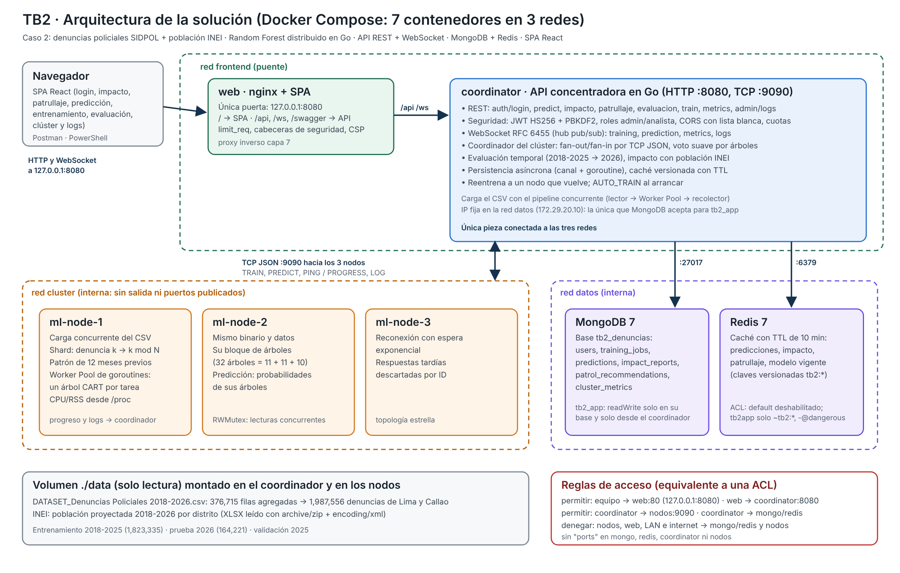

# TB2 · Random Forest distribuido para el patrullaje preventivo (Grupo 3)

Trabajo final de **CC65 Programación Concurrente y Distribuida** (UPC, 2026-20), Caso 2 del enunciado: clasificación de
delitos urbanos con las **denuncias policiales del SIDPOL (MININTER)** y la **población proyectada del INEI**.

| Integrante | Código | GitHub |
|---|---|---|
| Karim Samanamud | U201816862 | KarimS21 |
| Tomás Pastor | U201916314 | magic-tps |
| Juan Diego Sánchez | U202221147 | jotabe12 · jotade-2 |

**Pregunta de impacto social:** ¿en qué distritos de Lima Metropolitana y Callao, en qué mes y para qué delitos de calle
conviene priorizar el patrullaje preventivo, y a cuántas personas cubre esa priorización?



## Qué hay en esta carpeta

| Parte del enunciado | Implementación |
|---|---|
| A. Cargador concurrente (> 1 M registros) | `internal/dataset`: lector → canal con búfer → Worker Pool → recolector ordenado. 376,715 filas agregadas → **1,987,556 denuncias** de Lima y Callao |
| B. Entrenamiento distribuido | `internal/forest` (CART con Gini, Worker Pool de goroutines) + `internal/worker` (nodo ML) + `internal/cluster` (coordinador TCP en estrella, fan-out/fan-in) |
| C. API concentradora | `internal/api`: REST + WebSocket (RFC 6455 en `internal/ws`), JWT HS256 y PBKDF2 (`internal/auth`), CORS, cuotas, métricas y logs (`internal/logbuf`, `internal/sysmetrics`) |
| D. Visualización de impacto | `web/`: SPA en React (login, impacto social, plan de patrullaje, predicción, entrenamiento, evaluación, clúster y logs) servida por nginx |
| Bases de datos | MongoDB (usuarios, entrenamientos, predicciones, reportes de impacto, métricas) y Redis (caché con TTL) |
| Despliegue | `docker-compose.yml`: 7 contenedores en 3 redes (frontend, cluster y datos internas) |

## Cómo levantarlo (Windows + Docker Desktop)

```powershell
cd tb2
.\scripts\01_levantar.ps1        # crea .env con claves aleatorias, construye y levanta todo, entrena el modelo
```

- Aplicación: <http://localhost:8080> — usuarios de demostración en `.env` (`admin` y `analista`).
- Swagger UI: <http://localhost:8080/swagger> (botón **Authorize** con el token de `POST /api/v1/auth/login`).
- Postman: `postman/TB2_Grupo3.postman_collection.json` (ejecute primero las dos peticiones de login).
- Apagar: `.\scripts\99_apagar.ps1` (`-Borrar` también elimina el volumen de MongoDB).

El primer `up` descarga imágenes, módulos de Go y paquetes de npm. Los secretos (`JWT_SECRET`, contraseñas de MongoDB y
Redis) se generan al azar y **no** se suben (`.env` está en `.gitignore`).

## Evidencias (scripts en `scripts/`, resultados en `evidencias/`)

| Script | Qué mide | Archivos |
|---|---|---|
| `02_pruebas_api.ps1` | Login, 20 predicciones sin y con caché, validaciones 400/401/403/404/405, impacto, patrullaje | `02_pruebas_api.json` |
| `03_resiliencia.ps1` | Cae un nodo, la API sigue con 2; el nodo vuelve y se reentrena solo | `03_resiliencia.json` |
| `04_evidencias_bd.ps1` | MongoDB, Redis, redes y pruebas de aislamiento (equivalente a una ACL) | `04_*.txt`, `04_seguridad_red.json` |
| `05_go_test.ps1` | `go vet` + `go test -race` (11 paquetes) en un contenedor `golang:1.24` | `05_go_test.txt` |
| `06_speedup.ps1` | Speedup y eficiencia con 1-3 nodos × 1-8 goroutines (Karp-Flatt) | `06_speedup.json/.csv` |
| `07_metricas_modelo.ps1` | Validación 2025 y prueba 2026: exactitud, top-3, F1, matriz de confusión, comparación pc4/base/tb2 | `07_metricas.json/.csv/.txt` |
| `08_carga_api.ps1` | 10, 50 y 100 clientes concurrentes (generador en Go): p50/p95/p99 y throughput | `08_carga_api.json/.csv` |
| `09_e2e_seguridad.ps1` | Flujo completo con WebSocket, MongoDB y Redis + JWT, roles, CORS, intentos de login y cuota | `09_e2e_seguridad.json/.csv` |
| `10_impacto.ps1` | Respuesta a la pregunta de impacto: top-10 por mes, población cubierta y verificación con 2026 | `10_impacto.json/.csv/.txt` |

## Modelo

- **Variables (conjunto `tb2`)**: distrito, zona, mes, año y el *patrón criminológico reciente* del distrito (la mezcla de
  modalidades y el volumen de los 12 meses previos). Solo usa el pasado: no hay fuga de información.
- **Corrección respecto a la PC4**: la franja horaria imputada se generaba a partir de la clase real (supuesto de la PC3) y
  entraba como variable, lo que inflaba la exactitud. El TB2 la retira del modelo; se conserva el conjunto `pc4` solo para
  medir esa diferencia (`07_metricas_modelo.ps1`). La franja que muestra la UI está marcada como **supuesto**.
- **Partición temporal**: validación (2018-2024 → 2025) para elegir variables e hiperparámetros; prueba final
  (2018-2025 → 2026) una sola vez.
- **Distribución**: N nodos; la denuncia *k* va al shard *k mod N* (estratificado); cada nodo entrena su bloque de árboles
  con un Worker Pool; el coordinador promedia las probabilidades ponderando por número de árboles (voto suave). Probado:
  el bosque distribuido da exactamente las mismas probabilidades que los mismos árboles en un solo proceso.

## Seguridad (políticas de la API y de la red)

- JWT HS256 (biblioteca estándar), contraseñas con PBKDF2-HMAC-SHA256 (210,000 iteraciones, sal aleatoria).
- Roles: `admin` (entrenar, métricas, logs) y `analista` (consultas, cuota de 300 peticiones por minuto).
- CORS con lista blanca (también se valida el `Origin` del WebSocket); 10 intentos de login fallidos por IP y minuto.
- nginx es la única puerta (127.0.0.1:8080). MongoDB y Redis no publican puertos y viven en una red interna; el usuario
  de MongoDB solo acepta conexiones desde la IP del coordinador y el de Redis solo puede usar claves `tb2:*`.

## Fuentes de datos

Ver [`data/FUENTE.md`](data/FUENTE.md).
